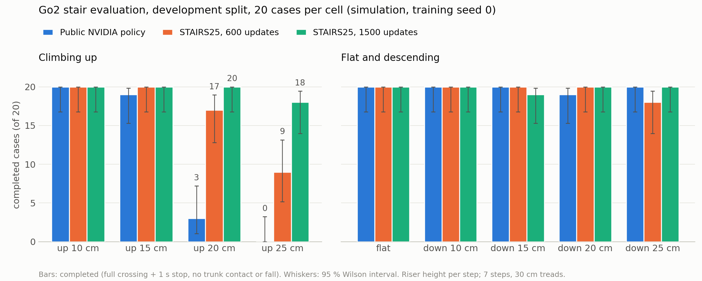

# Go2 机械狗爬楼梯 · 强化学习训练套件

在 Isaac Lab 仿真里用 PPO 训练宇树 Go2 四足机器人爬 20–25 cm 的楼梯。仓库包含：

- 完整的训练、评测、诊断代码（`src/go2_stairs/`）
- 两个训练好的参考模型（600 次和 1500 次更新）
- 参考评测结果、视频和轨迹数据
- 实验手册和报告模板

参考成绩（仿真，种子 0，开发集，每格 20 个用例）：

| 上楼台阶高度 | NVIDIA 公开策略 | 本套件 600 次更新 | 本套件 1500 次更新 |
|---|---|---|---|
| 20 cm | 3/20 | 17/20 | 20/20 |
| 25 cm | 0/20 | 9/20 | 18/20 |



> **范围：仅仿真。** 这里的任何内容都没有在真机上运行过。

---

## 先选一条路线

| 路线 | 需要什么 | 能做什么 |
|---|---|---|
| **A. 分析路线** | 任意电脑，Python 3.11，CPU 即可 | 跑测试、看参考结果、分析失败轨迹、对比结果、编写和校验训练配置 |
| **B. 完整路线** | NVIDIA RTX 显卡（显存 ≥ 12 GB，参考结果用 16 GB 的 RTX 5080 Laptop）+ Isaac Sim / Isaac Lab | 以上全部，加上自己训练和评测 |

第一次接触建议先走路线 A，五分钟就能看到结果。

---

## 路线 A：五分钟上手（不需要显卡）

### 1. 克隆仓库

克隆到**不含空格和中文**的路径（Isaac Sim 在 Windows 上遇到非 ASCII 路径会出错）：

```powershell
git clone https://github.com/qianen6/go2-stairs-rl.git C:\go2-stairs-rl
```

国内网络访问 GitHub 较慢时，可以改用 Gitee 镜像（内容相同）：

```powershell
git clone https://gitee.com/qainen/go2-stairs-rl.git C:\go2-stairs-rl
```

仓库约 220 MB（主要是参考视频和轨迹）。

### 2. 准备 Python

需要 Python 3.11 和两个包：

```powershell
py -3.11 -m venv C:\go2-stairs-rl\.venv
C:\go2-stairs-rl\.venv\Scripts\python.exe -m pip install numpy torch
```

### 3. 设置环境变量

每开一个新的 PowerShell 窗口都要执行一次：

```powershell
$kit = 'C:\go2-stairs-rl'
$py  = "$kit\.venv\Scripts\python.exe"
$env:PYTHONPATH = "$kit\src"
$env:PYTHONIOENCODING = 'utf-8'
```

Linux / macOS 对应写法：

```bash
kit=~/go2-stairs-rl
py=$kit/.venv/bin/python
export PYTHONPATH=$kit/src PYTHONIOENCODING=utf-8
```

（下文命令以 PowerShell 为例；Linux 下把 `& $py` 换成 `$py`，把 `\` 换成 `/`。）

### 4. 验证安装

```powershell
& $py -m unittest discover -s "$kit\tests" -p test_stairs25.py
& $py -m go2_stairs.stairs25_profile check "$kit\configs\stairs25-v1.json"
```

应当看到 `Ran 21 tests ... OK` 和 `0 change(s) vs STAIRS25_V1`。

> `tests/` 里其他测试文件依赖 Isaac / MuJoCo，在路线 A 的环境里失败是正常的。

### 5. 看看参考结果

```powershell
# 参考模型的评测矩阵
type "$kit\reference-results\v1-1500-dev\MATRIX.txt"

# 公开策略为什么爬不上 20 cm 台阶（逐个用例分类）
& $py -m go2_stairs.trace_report "$kit\reference-results\traces\public-dev-up20"

# 公开策略 vs 本套件，带置信区间和显著性检验
& $py -m go2_stairs.stairs25_compare "$kit\reference-results\public-dev\MATRIX.json" "$kit\reference-results\v1-1500-dev\MATRIX.json" --labels public stairs25

# 新建一份自己的训练配置
& $py -m go2_stairs.stairs25_profile new STUDENT_MYTEAM_IDEA
```

视频在 `reference-results\*\up20\*.mp4` 和 `up25\*.mp4`。

---

## 路线 B：完整环境（训练需要显卡）

### 参考软件版本

参考结果是用下面这套版本产生的。版本不同也能训练，但会在 `status.json` 里记录 `runtime_warning`。

| 组件 | 版本 |
|---|---|
| 操作系统 | Windows 11（Linux 也可以） |
| Python | 3.11 |
| Isaac Sim | 5.1.0.0 |
| Isaac Lab | v2.3.2（提交 `37ddf626871758333d6ed89cf64ad702aef127d0`） |
| PyTorch | 2.7.0 + CUDA 12.8 |
| rsl-rl-lib / tensordict | 3.1.2 / 0.11.0 |

完整的包版本清单见 `configs/requirements-runtime.txt`（这是参考机器的 `pip freeze` 记录，里面有本机路径，**仅供对照版本，不能直接 `pip install -r`**）。

### 1. 安装 Isaac Sim 和 Isaac Lab

按 [Isaac Lab 官方安装指南（pip 方式）](https://isaac-sim.github.io/IsaacLab/main/source/setup/installation/pip_installation.html) 操作，以官方文档为准。大致步骤如下，目录以 `C:\rl-runtimes` 为例：

```powershell
# 独立的虚拟环境
py -3.11 -m venv C:\rl-runtimes\go2-isaac
$py = 'C:\rl-runtimes\go2-isaac\Scripts\python.exe'
& $py -m pip install --upgrade pip

# PyTorch 和 Isaac Sim
& $py -m pip install torch==2.7.0 torchvision==0.22.0 --index-url https://download.pytorch.org/whl/cu128
& $py -m pip install "isaacsim[all,extscache]==5.1.0" --extra-index-url https://pypi.nvidia.com

# Isaac Lab v2.3.2（先激活虚拟环境，再运行它的安装脚本）
git clone https://github.com/isaac-sim/IsaacLab.git C:\rl-runtimes\IsaacLab
cd C:\rl-runtimes\IsaacLab
git checkout v2.3.2
C:\rl-runtimes\go2-isaac\Scripts\Activate.ps1
.\isaaclab.bat --install rsl_rl
```

首次启动 Isaac Sim 会下载和缓存资源，需要较长时间和稳定的网络。

### 2. 设置环境变量

每开一个新的 PowerShell 窗口都要执行一次：

```powershell
$kit = 'C:\go2-stairs-rl'
$py  = 'C:\rl-runtimes\go2-isaac\Scripts\python.exe'   # 你的 Isaac Lab Python
$env:PYTHONPATH = "$kit\src"
$env:PYTHONIOENCODING = 'utf-8'
$env:OMNI_KIT_ACCEPT_EULA = 'YES'
$env:GO2_RUNTIME_CWD = 'C:\rl-runtimes'               # Isaac Sim 的启动目录，必须是纯 ASCII 路径
$env:GO2_ISAACLAB_ROOT = 'C:\rl-runtimes\IsaacLab'    # Isaac Lab 源码目录，用来记录版本
Set-Location $env:GO2_RUNTIME_CWD
```

| 变量 | 作用 | 不设置时 |
|---|---|---|
| `PYTHONPATH` | 让 Python 找到 `go2_stairs` 包 | 必须设置 |
| `OMNI_KIT_ACCEPT_EULA` | 接受 Isaac Sim 许可协议，避免交互提示 | 启动时会询问 |
| `GO2_RUNTIME_CWD` | Isaac Sim 子进程的工作目录 | `C:\rl-runtimes` 存在则用它，否则用仓库根目录 |
| `GO2_ISAACLAB_ROOT` | Isaac Lab 源码位置 | 默认 `C:\rl-runtimes\IsaacLab` |
| `PYTHONIOENCODING` | 避免控制台中文乱码 | 可能乱码 |

### 3. 验证安装

```powershell
& $py -m unittest discover -s "$kit\tests" -p test_stairs25.py
& $py -m go2_stairs.stairs25_profile check "$kit\configs\stairs25-v1.json"
```

### 4. 下载 NVIDIA 公开模型（可选）

只有用 `--init public` 从公开策略开始训练时才需要。这个文件不随仓库分发：

```powershell
$url = 'https://omniverse-content-production.s3-us-west-2.amazonaws.com/Assets/Isaac/5.1/Isaac/IsaacLab/PretrainedCheckpoints/rsl_rl/Isaac-Velocity-Rough-Unitree-Go2-v0/checkpoint.pt'
Invoke-WebRequest $url -OutFile "$kit\checkpoints\public_rough_go2.pt"
(Get-FileHash "$kit\checkpoints\public_rough_go2.pt" -Algorithm SHA256).Hash
```

哈希应为 `F2AA77BF0349C10EC2A00071162E37123D0CF80F3447C3989C17A618E1B24AD2`。

---

## 训练一轮（需要显卡）

流程是：新建配置 → 改一处 → 校验 → 训练 → 评测 → 诊断。

```powershell
# 1. 新建并校验配置（生成 configs\students\student_myteam_idea.json，编辑后再校验）
& $py -m go2_stairs.stairs25_profile new STUDENT_MYTEAM_IDEA
& $py -m go2_stairs.stairs25_profile check "$kit\configs\students\student_myteam_idea.json"

# 2. 从参考模型微调 300 次更新（约 1–1.3 小时）
& $py -m go2_stairs.stairs25 --profile "$kit\configs\students\student_myteam_idea.json" --init finetune `
    --checkpoint "$kit\checkpoints\stairs25-v1-1500.pt" --output "$kit\runs\myteam-idea-s0" --updates 300 --headless

# 3. 评测（完整开发集矩阵约 10 分钟）
& $py -m go2_stairs.stairs25_matrix --checkpoint "$kit\runs\myteam-idea-s0\native\model_299.pt" --output "$kit\reports\myteam-idea-s0-dev"

# 4. 诊断失败用例，并和参考结果对比
& $py -m go2_stairs.trace_report "$kit\reports\myteam-idea-s0-dev\up25"
& $py -m go2_stairs.stairs25_compare "$kit\reference-results\v1-1500-dev\MATRIX.json" "$kit\reports\myteam-idea-s0-dev\MATRIX.json" --labels reference mine
```

### 训练的起点（`--init`）

| 取值 | 从哪里开始 | 典型用途 |
|---|---|---|
| `public` | NVIDIA 公开模型（校验哈希） | 与参考结果可比的消融实验 |
| `finetune` | 任意本套件模型，如 `checkpoints\stairs25-v1-1500.pt` | 在参考模型上改进 |
| `resume` | **同一份配置**的检查点 | 续训中断或太短的训练 |
| `scratch` | 随机权重（不带 `--checkpoint`） | 从零训练，耗时长 |

### 常用参数

| 参数 | 默认 | 说明 |
|---|---|---|
| `--updates` | 600 | PPO 更新次数 |
| `--num-envs` | 4096 | 并行机器人数量；要和参考结果对比就保持 4096 |
| `--seed` | 0 | 随机种子 |
| `--output` | 必填 | 必须是新目录，不会覆盖已有结果 |
| `--headless` | — | 不开图形界面，训练时建议加上 |
| `--wall-seconds` | 900 + 25 × 更新次数 | 训练的时间上限，超时后用 `--init resume` 续训 |
| `--strict-runtime` | 关 | 软件版本与参考不一致时拒绝启动 |

训练进度看 `runs\<名称>\status.json`，或用 TensorBoard：`tensorboard --logdir runs\<名称>\native`。检查点每 50 次更新保存一次，位于 `runs\<名称>\native\model_<k>.pt`。

### 耗时参考（RTX 5080 Laptop，4096 个机器人）

| 任务 | 时间 |
|---|---|
| 1 次 PPO 更新 | 12–15 秒 |
| 微调 300 次更新 | 约 1–1.3 小时 |
| 从公开模型训练 600 次更新 | 约 2–2.5 小时 |
| 快速评测（2 格 × 8 个用例） | 约 3 分钟 |
| 完整评测矩阵（9 格 × 20 个用例） | 约 10 分钟 |

---

## 修改训练配置

训练任务由一份 JSON 配置（profile）描述。参考配置 `configs/stairs25-v1.json` 是冻结的，不能直接改；用 `stairs25_profile new` 复制一份再改。

| 配置段 | 内容 |
|---|---|
| `fixes` | 六个开关：`actuators`、`head_termination`、`contact_penalties`、`foot_clearance`、`terrain`、`commands` |
| `actuators` | 电机刚度、阻尼、力矩和速度上限 |
| `rewards` | 奖励项权重，可用 `extra_terms` 添加自定义奖励 |
| `terminations` | 终止条件，可用 `extra_terms` 添加自定义终止 |
| `terrain` | 地形行列数、台阶高度范围、踏面深度、各类地形比例 |
| `commands` | 速度命令范围 |
| `ppo` | 学习率、目标 KL、critic 预热长度 |

某一段的数值只有在对应的 `fixes` 开关为 `true` 时才生效。

自定义奖励或终止函数写在 `src/go2_stairs/student_terms/<队名>.py`，函数签名参考同目录的 `examples.py`，完整示例见 `configs/students/student_example_leg_force.json`。

`src/go2_stairs/` 下除 `student_terms/` 以外的代码是冻结的：每份评测结果都记录了源码哈希，`tools/audit_submission.py` 会据此检查。

---

## 常见问题

| 现象 | 处理 |
|---|---|
| Isaac Sim 启动卡住或报路径错误 | 仓库路径或 `GO2_RUNTIME_CWD` 含空格或中文，换成纯 ASCII 路径 |
| `ModuleNotFoundError: go2_stairs` | 没有设置 `PYTHONPATH`，重新执行环境变量那一步 |
| `INVALID: STAIRS25_V1 is the frozen reference profile` | 改动了 `configs/stairs25-v1.json`；用 `git checkout configs/stairs25-v1.json` 还原，再用 `stairs25_profile new` 新建 |
| `checkpoint profile cannot be verified` | 检查点或参考配置被改动过 |
| `resume requires the same profile file` | 配置改过了，改用 `--init finetune` |
| `--output` 报 `FileExistsError` | 换一个新的目录名 |
| `TimeoutError: training wall-time limit` | 用 `--init resume` 从最后一个 `model_<k>.pt` 续训 |
| CUDA 显存不足 | 关闭其他占用显卡的程序；探索性实验可以降低 `--num-envs`，但结果不能与参考对比 |
| 控制台中文乱码 | 执行 `chcp 65001`，并设置 `PYTHONIOENCODING=utf-8` |
| 源码哈希审计失败 | 检查 Git 是否转换了换行符；本仓库的 `.gitattributes` 已禁用转换，不要覆盖它 |

---

## 目录结构

| 路径 | 内容 |
|---|---|
| `src/go2_stairs/stairs25.py` | 训练入口 |
| `src/go2_stairs/stairs25_profile.py` | 配置的新建和校验 |
| `src/go2_stairs/stairs25_matrix.py`、`landing_eval.py` | 评测 |
| `src/go2_stairs/trace_report.py`、`stairs25_compare.py` | 诊断和对比 |
| `src/go2_stairs/student_terms/` | 自定义奖励和终止函数 |
| `configs/stairs25-v1.json` | 冻结的参考配置 |
| `configs/students/` | 自己的配置，含一个完整示例 |
| `checkpoints/` | 参考模型（哈希见 `CHECKSUMS.txt`） |
| `reference-results/` | 开发集和测试集的评测矩阵、视频、两格完整轨迹 |
| `runs/`、`reports/` | 自己的训练和评测输出（不纳入版本管理） |
| `tests/` | 测试 |
| `tools/audit_submission.py` | 提交结果的审计工具 |
| `assets/go2/` | 宇树 Go2 的 MuJoCo 模型 |
| `docs/` | 这次修复背后的工程方案 |

`src/go2_stairs/` 里还保留了早期基线的代码（如 `train.py`、`env.py`）。它们额外依赖 `unitree_rl_lab` 和本地的 Go2 USD 资源，上面的主流程用不到。

## 更多文档

- [LAB_MANUAL.md](LAB_MANUAL.md)：实验手册（英文），包括任务背景、案例分析、工具说明、实验规则和作业
- [REPORT_TEMPLATE.md](REPORT_TEMPLATE.md)：实验报告模板
- [docs/2026-10-19-go2-stairs25-fixes.md](docs/2026-10-19-go2-stairs25-fixes.md)：工程方案

## 许可

宇树 Go2 模型和 Isaac Lab 相关部分为 BSD-3 许可，见 `LICENSES/` 和 `assets/UNITREE_LICENSE`，模型来源见 `assets/PROVENANCE.json`。
